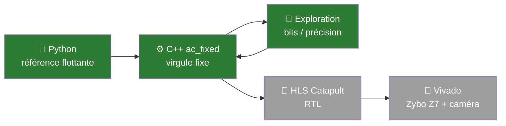
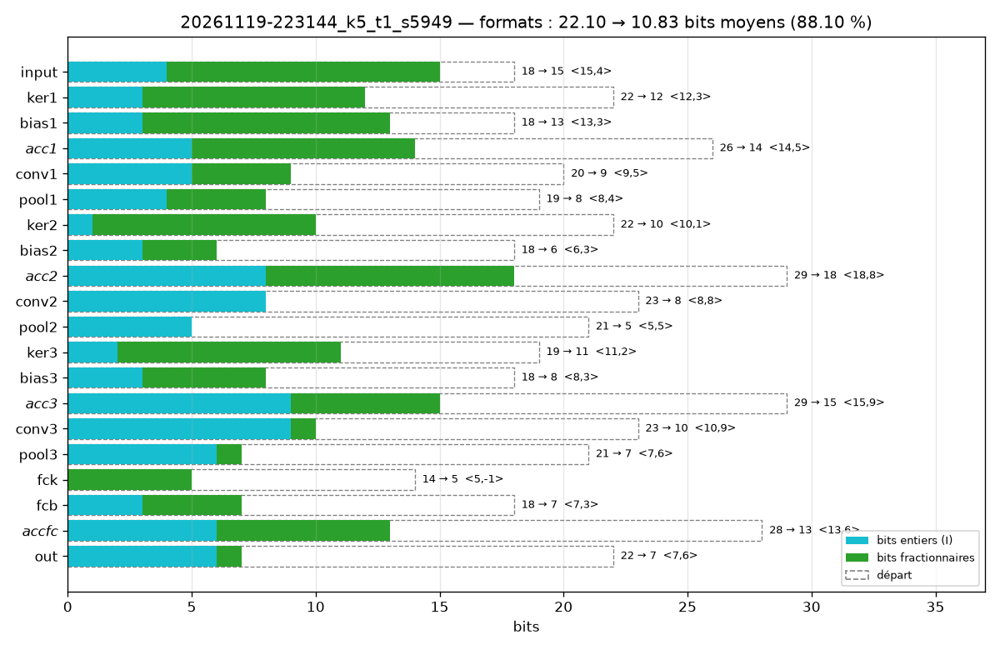
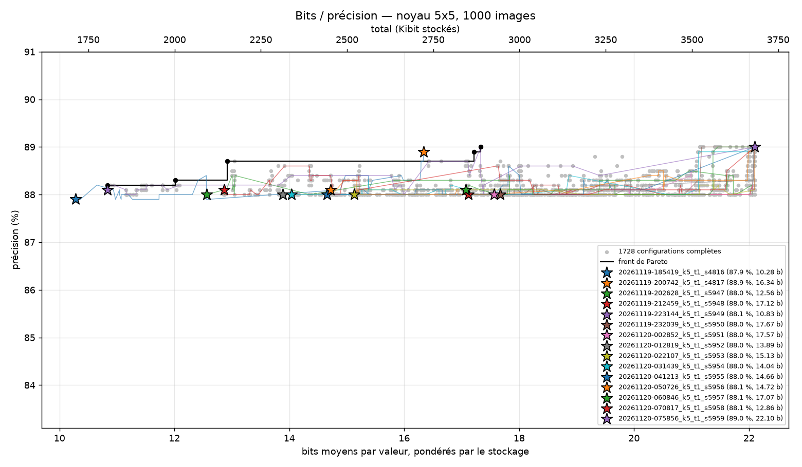

# CNN CIFAR-10 sur SoC — de Python au FPGA

> Projet d'intégration **SEI – SoC** · Phelma S9 · module AlgoArchi
> Porter un réseau de neurones convolutif déjà entraîné jusqu'à une carte **Zybo Z7**
> avec caméra et affichage HDMI, en passant par la virgule fixe et la synthèse de haut niveau (HLS).



| Étape | Dossier | État |
|---|---|:---:|
| Référence algorithmique Python | [`python/`](python/) | ✅ |
| Modèle C++ en virgule fixe (`ac_fixed`) | [`cpp/`](cpp/) | ✅ |
| Exploration automatique des formats | [`Exploration/`](Exploration/) | ✅ |
| Synthèse HLS (Catapult) | [`hls/`](hls/) | ⏳ |
| Intégration FPGA (Vivado, Zybo Z7) | [`fpga/`](fpga/) | ⏳ |
| Rapport | [`rapport/`](rapport/) | ⏳ |

---

## Le réseau

Un CNN « basique » pour CIFAR-10 (10 classes, images 32×32), fourni déjà entraîné.
Seule l'**inférence** est implémentée.

```
 32×32×3 ──crop──▶ 24×24×3 ──normalisation (μ, σ globaux)
   │
   ├─ conv1 k×k, 3→64  + biais ─ ReLU ─ max-pool 3×3 /2 ─▶ 12×12×64
   ├─ conv2 k×k, 64→32 + biais ─ ReLU ─ max-pool 3×3 /2 ─▶  6×6×32
   ├─ conv3 k×k, 32→20 + biais ─ ReLU ─ max-pool 3×3 /2 ─▶  3×3×20
   └─ flatten (HWC) ─▶ 180 ─ perceptron 180×10 + biais ─▶ 10 scores ─ argmax
```

Deux jeux de coefficients sont fournis : noyaux **3×3** et **5×5** ([`data/coef/`](data/coef/)).

| Noyau | Max-pool | Précision (float, 10 000 images) |
|:---:|---|:---:|
| 3×3 | 3×3, fenêtre TF « SAME » | 77,03 % |
| **5×5** | **3×3, fenêtre TF « SAME »** | **87,81 %** |
| 5×5 | 3×3, fenêtre centrée | 74,51 % |
| 5×5 | 5×5, fenêtre TF « SAME » | 71,27 % |

La position de la fenêtre de max-pool compte : le réseau a été entraîné avec TensorFlow
(`padding='SAME'`, fenêtre `[2i, 2i+2]`). Avec une fenêtre centrée, on perd 13 points.

---

## Démarrage rapide

**Prérequis** : Python ≥ 3.10, g++ (C++17), CMake ≥ 3.10, et la base CIFAR-10 binaire dans
`data/cifar-10-batches-bin/` (à extraire de `data/SEI_data.tgz` ; elle n'est pas versionnée).

```bash
make            # liste toutes les commandes
make venv       # crée .venv et installe requirements.txt
make run        # lance la référence Python (python/main.py)
```

### Modèle C++ virgule fixe

```bash
cmake -S cpp -B cpp/build
cmake --build cpp/build -j
cpp/build/main 1000 5        # 1000 images, noyau 5×5  →  ~89 %, ~30 ms/image
```

```
Usage : main [nb_images=100] [k_size=5] [batch=data_batch_1.bin] [--order FICHIER] [--trace]
```

Tous les formats `ac_fixed<W, I, S>` sont réglés dans [`cpp/config.hpp`](cpp/config.hpp).
On peut aussi les changer à la compilation sans toucher au code :

```bash
cmake -S cpp -B cpp/build -DCMAKE_CXX_FLAGS="-DCONV1_W=12 -DCONV1_I=6"
```

---

## Virgule fixe : combien de bits faut-il vraiment ?

Le modèle C++ décrit chaque grandeur avec son propre type : image d'entrée, poids, biais,
accumulateurs, sorties de convolution, sorties de max-pool, scores. Cela fait **20 formats**,
soit 40 paramètres (bits entiers *I* et fractionnaires *F*).

1. **Dynamique en flottant** : [`python/amplitude.py`](python/amplitude.py) mesure min/max et
   percentiles de chaque étape et propose un premier type
   ([`Results/amplitude_*.md`](Results/)).
2. **Exploration automatique** : [`Exploration/explore.py`](Exploration/explore.py) part d'une
   configuration large puis réduit les bits format par format. La recherche est d'abord
   exponentielle, puis dichotomique en parallèle. On garde la plus petite valeur dont la
   précision reste à moins de 1 point de la référence.
   - Les images sont triées de la plus incertaine à la plus sûre. Une **comparaison appariée
     avec la référence** arrête tôt les configurations perdues d'avance.
   - Un cache des évaluations est partagé par tous les runs. Les sessions peuvent être
     interrompues puis reprises, et un tableau de bord `rich` suit le run en direct.

```bash
.venv/bin/python Exploration/explore.py run --runs 3 --parallel-vars 2
.venv/bin/python Exploration/explore.py list               # toutes les explorations
.venv/bin/python Exploration/explore.py pareto             # meilleurs compromis
.venv/bin/python Exploration/explore.py select <run> --apply   # écrit cpp/config.hpp
```

### Résultats (noyau 5×5, 1000 images, tolérance 1 point)

Le meilleur run descend de **22,1 à 10,8 bits moyens par valeur stockée**. La précision passe
de 89,0 % à 88,1 %, soit environ 2× moins de mémoire.



Chaque étoile ci-dessous est la configuration finale d'un run. Le trait noir est le front de
Pareto sur les 1728 configurations évaluées. L'ordre dans lequel on réduit les variables change
nettement le résultat final : selon le run, on termine entre 10,8 et 17,7 bits.



---

## Organisation du dépôt

```
python/        référence algorithmique (boucles + version numpy vectorisée, ~1000× plus rapide)
cpp/           modèle C++17 virgule fixe : config.hpp (formats), cnn.cpp, utils.* (couches), main.cpp
Exploration/   outil d'exploration bits/précision (explo/ = modules, runs/ = résultats)
Results/       rapports : précision Python, dynamique des valeurs
data/          CIFAR-10 (non versionné) et coefficients du réseau (data/coef/)
hls/include/   ac_fixed.h, ac_int.h (types Algorithmic C)
doc/           sujet (SEI_CNN.pdf), boîte à outils HLS/Zybo, référence ac_datatypes
fpga/          projet Vivado (à venir)
rapport/       rapport final (à venir)
```

L'arborescence est imposée et vérifiée par `make tree-check`.

## Prochaines étapes

- [ ] Séparer le testbench de l'unité de calcul et remplacer `std::vector` par des tableaux de
      taille fixe, synthétisables par Catapult
- [ ] Première HLS sur une seule convolution, puis sur le CNN complet (surface, latence)
- [ ] Vérification SCVerify par rapport au modèle C++
- [ ] Intégration sur Zybo Z7 : convolution sur flux vidéo live, puis classification
- [ ] Rapport et soutenance

## Documentation

- [`doc/SEI_CNN.pdf`](doc/SEI_CNN.pdf) : sujet du projet, méthodologie, description du réseau
- [`doc/BoiteAOutilsHLSImage.pdf`](doc/BoiteAOutilsHLSImage.pdf) : Catapult, Vivado, plateformes Zybo Z7
- [`doc/ac_datatypes_ref.pdf`](doc/ac_datatypes_ref.pdf) : référence `ac_fixed` / `ac_int`
- [`CLAUDE.md`](CLAUDE.md) : notes techniques détaillées (conventions, pièges, état du projet)
